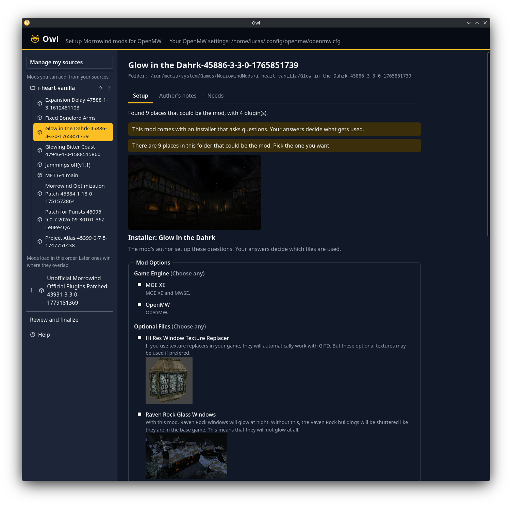
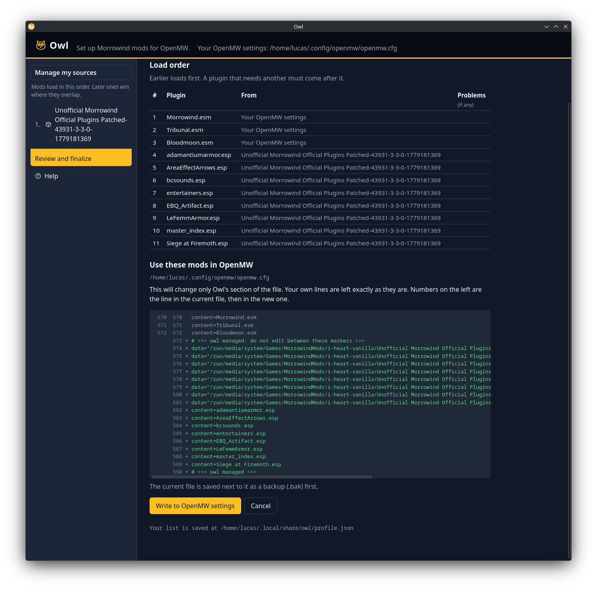

# Owl

**Set up a modded Morrowind without learning how OpenMW's config works.**

Owl is a mod manager for [OpenMW](https://openmw.org). You point it at the mods you've downloaded, put them in order, and press one button. Owl writes the OpenMW settings for you, and shows you exactly what it will change before it does.

- **Understands FOMOD installers.** Many mods ship an installer that asks questions ("which texture size?", "which patch?"). Owl reads it, asks you those questions in plain language, and works out which folders and plugins your answers mean. It never copies or changes the mod's files. (Installers that rename files or copy them into new subfolders can't be turned into OpenMW folders yet; Owl tells you when that's the case.)
- **Load order that explains itself.** Mods that need other mods are checked, problems are flagged with a ⚠, and one button offers to fix the order, showing what it would move first.
- **Safe by design.** Owl only edits its own marked section of `openmw.cfg`, keeps a `.bak` backup, and leaves the rest of your file alone. It also works alongside the OpenMW Launcher.
- **Desktop app and command line.** Most people want the app. The command-line tool is there for scripting.

## Getting started

### 1. You need

- A copy of Morrowind and [OpenMW](https://openmw.org/downloads/) installed and run at least once, so it has created its settings file.
- A Windows or Linux (x86-64) computer.

### 2. Download Owl

Go to the [**Releases** page](../../releases/latest) and download the file that matches your system, under **Assets**:

| You use | Download |
|---|---|
| Windows | `Owl_<version>_x64-setup.exe` |
| Linux (any distribution) | `Owl_<version>_amd64.AppImage` |
| Debian, Ubuntu, Mint | `Owl_<version>_amd64.deb` |
| Fedora, openSUSE | `Owl-<version>-1.x86_64.rpm` |

Ignore the two files called **Source code**; GitHub adds them to every release.

The files starting with `CLI_Owl_` are the command-line tool, not the app. You only need them if you want to use Owl from a terminal or a script.

### 3. Install and open it

- **Windows:** run the installer. Windows may warn that it's from an unknown publisher, because the installer isn't code-signed yet. Choose **More info**, then **Run anyway**.
- **AppImage:** make the file executable (right-click, Properties, Permissions, or `chmod +x Owl_*.AppImage`), then run it.
- **`.deb`:** `sudo apt install ./Owl_*.deb`
- **`.rpm`:** `sudo dnf install ./Owl-*.rpm`

Owl finds your `openmw.cfg` on its own and tells you if it can't.

### 4. Download a mod

Owl doesn't download mods for you yet, so you get them from a mod site.

[Nexus Mods](https://www.nexusmods.com/morrowind) is a good place to start and has the largest Morrowind collection, but you can use any source. Owl only needs a folder of mod files. Nexus needs a free account to download.

1. Find a mod and open its **Files** tab.
2. Choose **Manual download** (not a mod-manager download) and save the archive.

### 5. Unpack it

Extract the archive (`.zip`, `.7z` or `.rar`) into its own folder. Owl works with extracted folders, so a mod you haven't extracted can't be added.

Keep your mods somewhere permanent, such as `Documents/Morrowind Mods`. Owl remembers where each mod is, so moving or deleting the folder breaks it on your list.

### 6. Add it to Owl

1. Press **Manage my sources**, then **Add a source**, and pick the mod's folder. Or pick one folder that holds many mods (a *source*), and Owl will list all of them. Owl remembers your sources for next time.
2. Open the mod. The **Author's notes** tab shows its readme, and **Needs** lists what it requires.
3. If the mod has an installer, answer its questions. Otherwise choose the folders you want.
4. Press **Add to my mods**.

### 7. Put them in order and apply

Mods lower in the list load later and win when two mods change the same thing. Select a mod and use **Move up** or **Move down**. If a mod is in the wrong place, Owl flags it and offers **Fix the order for me**.

When you're happy, go to **Review and finalize**, press **Review changes**, check what Owl will write, and confirm. Nothing changes in OpenMW until you do.

Start OpenMW as you normally do. The app's **Help** page covers the same steps.

## Documentation

- [Desktop app](docs/owl-app/README.md)
- [Command-line tool](docs/owl-cli/README.md)
- [Library](docs/owl-core/README.md)
- [Releasing](docs/releasing.md)

## Mission

Reduce the cognitive load and manual labor of playing modded Morrowind, so the game can reach more people more easily.

The measure of success is the player's experience, not the elegance of the tooling. Concretely:

- A new player goes from "I own Morrowind" to "I'm playing a good modded setup" in as few steps as possible, ideally one.
- The player never has to understand datapaths, load order, `openmw.cfg`, or which tool does what.
- We do not add a step to an existing workflow. Anything that does is the wrong design, however clean it is internally.
- Expert users can still inspect and override everything, but that is never required.

Every design decision should be checked against this. If a feature serves maintainers or tool authors but not the player, it's secondary.

See [docs/research.md](docs/research.md) for background.

## License

Copyright (C) 2026 Lucas Morgan

Licensed under GPL-3.0-or-later. See `LICENSE`. Issues are welcome; pull requests are not accepted (see `CONTRIBUTING.md`).
